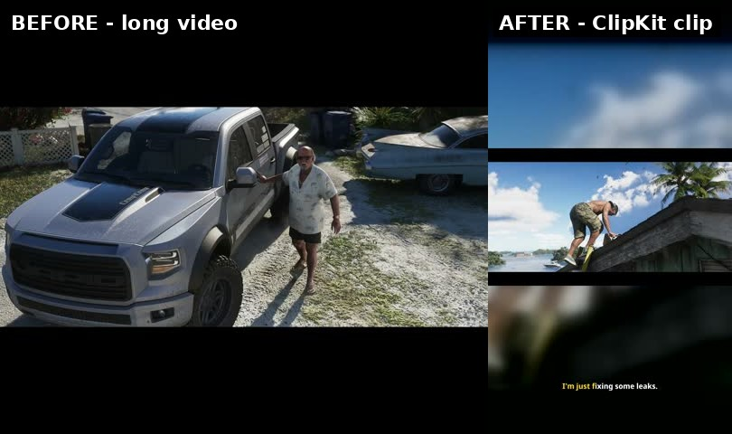
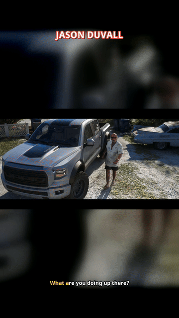

# GTA 6 ClipKit 🎬

**Turn a 30-minute GTA 6 video into ranked, ready-to-post vertical clips — free, local, no API keys.**

One long video in → ranked 9:16 clips out, each with a hook title, word-by-word kinetic captions, and audio levelled to −16 LUFS. Built for creators clipping GTA 6 (trailers, streams, long videos) — it works on any long video with speech.

> ClipKit finds the moments worth posting. It does not promise virality — it just does the boring 90% (watch, transcribe, cut, caption, format) so you can spend your time on the 10% that actually makes a clip land.

---

## What it does in 30 seconds

```
python3 clipkit.py my-long-gta6-video.mp4 --clips 3
```

| Step | What happens |
|---|---|
| 1 | Transcribes the whole video with whisper.cpp (CPU, on your machine) |
| 2 | Finds speech blocks, cuts candidate windows, snaps them to scene cuts |
| 3 | Scores each window — speech density, GTA 6 keywords (Vice City, Lucia, Jason, Leonida…), loudness, visual cut rate |
| 4 | Exports the top clips as 1080×1920 vertical video: tall sharp 4:5 scene over a blurred background (or full-bleed fill), big kinetic captions in the portfolio-reel style, hook title in the first 2 seconds, smooth-playback encode |
| 5 | Writes `clips.json` — every ranked clip with score, hook line, suggested caption |

## Demo — before / after

One long video in, ranked vertical clips out. This is from a real test run on this machine (GTA 6 Trailer 2, 2:47 → 3 clips):





## Install — one command

```bash
bash setup.sh
```

That checks for `ffmpeg` + `python3`, builds whisper.cpp if `whisper-cli` is missing, and downloads the `base.en` model (~142 MB). Zero budget, zero paid keys, no GPU needed.

Then:

```bash
python3 clipkit.py YOUR_LONG_VIDEO.mp4 --clips 3
ls out/
```

Outputs in `out/`:

| File | What it is |
|---|---|
| `clip_01.mp4` … | Ranked vertical clips (1080×1920, H.264 + AAC) |
| `clip_01.ass` … | The kinetic-caption subtitle file for each clip |
| `clips.json` | Ranked segments: start/end, score + breakdown, hook line, suggested caption, loudness, verification status |
| `analysis.json` | Cached transcript + candidates (so edit mode is instant) |

## Templates — ready-made edits, one flag

Four named presets in `templates/`. A template bundles framing, caption engine, hook style, zoom, speed and colours — one flag, a finished look. CLI flags override the template.

```bash
python3 clipkit.py video.mp4 --clip 1 --template bold
python3 clipkit.py video.mp4 --clip 1 --template viral-hook --hook "VICE CITY IS BACK"
```

| Template | Look | When to use it |
|---|---|---|
| `bold` | Portfolio-reel kinetic type. HyperFrames + GSAP transparent overlay: letter-stagger hook slam, big condensed-black captions (84px) with the spoken word in yellow, thin red progress bar, tall 4:5 scene, gentle zoom. | Default choice — the clip should look like the Muse portfolio reel. Maximum energy for the swipe feed. |
| `viral-hook` | Hook-first Shorts style. Huge whole-line hook slam (120px), giant 88px captions that pop word by word, 1.1× pace, hard 1.15× zoom punch. Animated ASS captions (fast render). | When the first 3 seconds decide everything — trend-jacking clips, trailer moments. |
| `cinematic` | Film look. Full-bleed 9:16 fill (frame edge to edge), small elegant 44px captions that fade, small white hook that fades in, no zoom. | Beautiful footage — sunsets, city shots, slow moments — where big captions would ruin the frame. |
| `minimal` | Clean and light. Blurred-background band, small plain 46px captions, no hook, no zoom, 720p output — smallest file, smoothest playback anywhere. | Talking-head / explainer clips where the words matter more than the look. |

Each template is one JSON file (`templates/<name>.json`) — copy one, change the colours, and it is yours. The four shipped looks are deliberately different: different framing, different caption engine, different hook treatment — not the same clip in a different colour.

## The clips don't look basic

Every exported clip has:

- **Hook title in the first 1–2 seconds** — the strongest line from the clip, big branded type, top of frame. `stagger` slams it in letter by letter (portfolio-reel style), `slam` drops the whole line at once, `fade` is quiet, `none` skips it.
- **Word-by-word kinetic captions** — big condensed-black caps; each word pops in (scale slam) in yellow (`#FFD60A`) and settles to white, timed to whisper's word timestamps. Two engines: `hf` renders the caption layer with HyperFrames + GSAP (the exact portfolio-reel v4 animation, composited as a transparent ProRes overlay in the same single encode); `ass` renders animated ASS captions (per-word pop + highlight, no browser needed, much faster). ClipKit uses `hf` when it can and falls back to `ass` automatically — `clips.json` records which engine was actually used.
- **Clean framing** — default is a tall 4:5 smart-crop of the source (1080×1350 sharp picture over a blurred background), ~2.2× taller than v0.1.0's thin 1080×608 band, so the scene reads as full quality on a phone. `blur` keeps the old full-frame band; `crop` fills the whole 9:16 screen (centre-crop, loses the sides). All scaling is lanczos, single encode, no double-encode loss, and no crop is ever upscaled beyond the source resolution.
- **Smooth playback** — constant frame rate at the source rate (no 24→30 judder), `medium` preset, CRF 20, 7 Mbps cap, `+faststart` so playback starts immediately. v0.1.0's 12 Mbps / 90 MB clips stuttered on phones; v0.2.0 clips are ~40–55 MB at 1080p. `--res 720` makes a 720×1280 version (~4 Mbps) for the smoothest playback anywhere.
- **Consistent branded look** — Noto Sans Display Condensed Black, red hook, yellow highlight, captions inside the safe zone (864 px centre column, bottom 160 px clear, never on a face where avoidable)
- **Zoom punch-in on the hook moment** — a gentle push in the first 2 seconds (configurable, disable with `--no-zoom`)
- **Audio levelled to −16 LUFS**, limiter at −1.5 dB

## Editing options — not just auto-cutting

Auto mode works with zero config. When you want a clip your way, re-export it with overrides — CLI flags or a JSON config file. Every option, with one example each:

| Option | What it does | Example |
|---|---|---|
| `--template NAME` | Use a named preset: `bold`, `viral-hook`, `cinematic`, `minimal` | `python3 clipkit.py video.mp4 --clip 1 --template bold` |
| `--trim START:END` | Re-cut one clip to exact source seconds | `python3 clipkit.py video.mp4 --clip 1 --trim 52.0:88.0` |
| `--hook TEXT` | Override the hook title | `python3 clipkit.py video.mp4 --clip 1 --hook "VICE CITY IS BACK"` |
| `--speed X` | Playback speed (captions re-time automatically) | `python3 clipkit.py video.mp4 --clip 2 --speed 1.15` |
| `--bg tall\|blur\|crop` | Tall 4:5 scene (default), blurred-background band, or full-bleed fill | `python3 clipkit.py video.mp4 --clip 1 --bg crop` |
| `--res 1080\|720` | Output height: 1080 (default) or 720 (smaller, smoothest) | `python3 clipkit.py video.mp4 --clip 1 --res 720` |
| `--caption-engine hf\|ass` | Kinetic caption engine (HyperFrames overlay / animated ASS) | `python3 clipkit.py video.mp4 --clip 1 --caption-engine ass` |
| `--hook-style slam\|stagger\|fade\|none` | Hook title animation | `python3 clipkit.py video.mp4 --clip 1 --hook-style slam` |
| `--hook-size N` | Hook title font size | `python3 clipkit.py video.mp4 --clip 1 --hook-size 120` |
| `--no-progress-bar` | Hide the thin red progress bar (hf engine) | `python3 clipkit.py video.mp4 --clip 1 --no-progress-bar` |
| `--crop-x N` | Shift the tall 4:5 crop window left/right (source px) | `python3 clipkit.py video.mp4 --clip 1 --crop-x -200` |
| `--no-zoom` | Disable the hook-moment zoom punch-in | `python3 clipkit.py video.mp4 --clip 1 --no-zoom` |
| `--zoom-factor X` | Zoom punch-in strength | `python3 clipkit.py video.mp4 --clip 1 --zoom-factor 1.18` |
| `--caption-color HEX` | Caption colour | `python3 clipkit.py video.mp4 --clip 1 --caption-color "#FFE66D"` |
| `--caption-highlight HEX` | Current-word highlight colour | `python3 clipkit.py video.mp4 --clip 1 --caption-highlight "#FF3B30"` |
| `--caption-position bottom\|top` | Caption position | `python3 clipkit.py video.mp4 --clip 1 --caption-position top` |
| `--caption-size N` | Caption font size | `python3 clipkit.py video.mp4 --clip 1 --caption-size 52` |
| `--font NAME` | Caption font family | `python3 clipkit.py video.mp4 --clip 1 --font "DejaVu Sans"` |
| `--config FILE` | Several edits at once (JSON, see below) | `python3 clipkit.py video.mp4 --config edit.json` |

Config file (`edit.json`) — edit several clips in one run:

```json
{
  "defaults": { "bg": "blur", "caption_color": "#FFFFFF" },
  "clips": [
    { "index": 1, "hook": "VICE CITY IS BACK", "speed": 1.15,
      "caption": { "color": "#FFE66D" } },
    { "index": 2, "trim": [120.5, 165.0], "bg": "crop", "zoom": false }
  ]
}
```

```bash
python3 clipkit.py video.mp4 --config edit.json
# -> out/clip_01_edit.mp4, out/clip_02_edit.mp4, out/clips_edited.json
```

Other flags: `--clips N` (how many top clips, default 3), `--model PATH`, `--whisper-bin PATH`, `--fast-seek` (keyframe seek — faster, but captions can drift up to a GOP; default is accurate seek).

## Verified on this machine

Tested end-to-end on a Linux VM (Python 3.12, ffmpeg 8.1, whisper.cpp `base.en`, no GPU):

- **GTA 6 Trailer 2** (2:47, 1920×1080, AV1) → 3 clips: 59.4 s (score 0.713, hook "JASON DUVALL"), 54.6 s (0.511), 25.0 s (0.426). 33 transcript cues, 211 words, 34 scene cuts. Loudness −15.6 / −16.0 / −16.0 LUFS; files 90.5 / 72.0 / 36.7 MB. Full run: ~7 min.
- **Long video** (Wirecard documentary, 11:42, 1280×720) → 3 clips: 43.5 s (0.773), 49.6 s (0.698), 48.4 s (0.676). 114 cues, 1,712 words, 141 scene cuts, 15 candidate windows. Loudness −15.7 / −15.8 / −15.3 LUFS; files 53.4 / 62.2 / 52.9 MB. Full run: ~7.5 min.
- **Edited variants** (config + CLI flags) → 2 verified end-to-end: hook override + 1.15× speed + recoloured captions (37.9 s output, −16.5 LUFS); re-trim + centre-crop + zoom off (35.0 s, −15.7 LUFS). Both decode-verified, A/V in sync, frames visually checked.
- Every output clip: decode-verified (`ffmpeg -v error`), A/V sync checked, loudness measured with ebur128, frames visually checked for caption timing, safe zones and framing. Two real bugs were caught and fixed during verification: whisper's `>>` speaker artefacts leaking into captions, and speed-up clips losing their tail (fixed in `export_clip`).

### v0.2.0 — smooth playback, tall framing, portfolio-reel captions, templates

The v0.1.0 clip 01 ("JASON DUVALL", 59.4 s) was re-exported with every fix, and all four templates were verified on Trailer 2:

- **Diagnosis (measured, not guessed).** The old clip's frame timestamps were perfectly even (0.0333 s × 1780, no duplicated frames) and `moov` was already at the front (faststart on) — so the phone stutter was the encode, not the timing: 12.1 Mbps / 90.5 MB from `ultrafast` + CRF 18. And the "low quality" was the framing: the sharp picture was only a 1080×608 band (32% of the frame height).
- **`bold` template (full clip, HyperFrames overlay)** — 59.36 s, 1080×1920, 30 fps CFR, 4.3 Mbps, 32.9 MB (was 90.5 MB), −15.9 LUFS, peak −2.6 dB. Decode OK, A/V sync OK, frame timestamps perfectly even, moov at offset 36. Hook letters stagger in (v4 style), word-by-word captions pop with the spoken word in yellow, red progress bar grows across the top. Verified on frames at 0.3 s / 2 s / 12 s / 30 s / 55 s.
- **`viral-hook` template (full clip, animated ASS)** — 53.96 s (59.36 s at 1.1×), 1080×1920, 4.46 Mbps, 31.0 MB, −15.9 LUFS, peak −2.4 dB. Decode OK, A/V sync OK. Whole-line hook slam at 120 px, 88 px captions. (A `>>` artefact found in the first render was fixed at the root — `transcribe()` now drops `>>` tokens and both caption builders strip them; the re-rendered ASS has 0 occurrences, confirmed in the file and on frames.)
- **`cinematic` template (20 s trim)** — 1080×1920, 4.7 Mbps, 12 MB, −15.7 LUFS, decode OK. Full-bleed fill, small 44 px white captions, fading hook.
- **`minimal` template (20 s trim)** — 720×1280, 1.8 Mbps, 4.9 MB, −15.7 LUFS, decode OK. Small blurred-background band, plain captions, no hook.
- **Before/after:** `verify/v2-compare/before-after-small.jpg` — same timestamps, old thin band + tiny captions vs new tall scene + big kinetic type. **Templates compared:** `verify/v2-templates/templates-4way.jpg`.
- **Caption engine note.** The HyperFrames route was proven, not assumed: a 3 s test overlay rendered as ProRes 4444 (`yuva444p12le`, ~99% of pixels fully transparent, ~2–3k partial-alpha edge pixels) and composited cleanly over a real clip frame with no fringe. The full 59 s overlay took ~9 min to render (screenshot capture, 1 worker, software GL) and is cached — re-exports reuse it. When HyperFrames is unavailable, or the clip is sped up, ClipKit falls back to the animated ASS engine automatically.
- **ASS quirk found and fixed.** This ffmpeg/libass renders ASS text at 0.724× the nominal size (measured at two font sizes: ink w/size 1.67 vs PIL 2.31). ClipKit compensates the ASS font sizes by 1/0.724 so the rendered glyphs match the PIL-measured word positions exactly (verified: phrase ink 117–961 px vs calculated 116–963 px).

### v0.2.2 — hard quality audit: no dead middles, captions inside the picture, hooks that fit

The v0.2.0 clip 01 was rejected on quality ("kharab quality ka content"). A frame-by-frame audit of the actual 59 s clip found three real defects, all fixed in the tool (not just in the clip):

- **Defect 1 — 25.4 s dead middle (clip 15.4–40.7 s, 43% of the clip) with zero captions, plus a second 7.0 s gap (clip 50.4–57.4 s).** Root cause: the greedy candidate builder extended a window across speech blocks whenever the total span stayed under 60 s — it never looked at the gap between blocks. Fix: `MAX_SPEECH_GAP = 5.0` — windows never span a speech gap over 5 s; `score_window` now reports `max_gap_s` and penalises any window that breaks the rule; `MIN_CLIP` is 15 s so a dense 15 s window beats a 60 s window with a hole in it. Re-running selection on Trailer 2 now ranks **9.8–25.2 s (15.4 s, 2.93 words/s, max gap 0.2 s, score 0.717)** first and **88.2–117.9 s (29.7 s, max gap 4.0 s, score 0.563)** second; the old 59 s window is gone.
- **Defect 2 — caption words sliced at the picture's bottom edge** ("just" at ~2.25 s, "you" at ~48 s, "leaks." at ~2 s). Root cause: captions were anchored at a fixed y=1620 assuming the tall picture fills its 1080×1350 box — but Trailer 2 is letterboxed (1920×864 inside 1920×1080), so the visible picture ends near y=1500 and the caption's bottom line hung below it. Fix: `detect_letterbox()` (cropdetect) + `picture_bounds()` map the real picture through the framing mode, and both caption engines anchor to the visible picture bottom minus 30 px. Word-pop scale reduced 1.7×→1.35× (HF) and 150%→135% (ASS) so glyphs can't overshoot the line box.
- **Defect 3 — hook title wrapped mid-word and clipped** ("WHAT ARE YOU DOING UP THERE?" is 1546 px wide at 110 px in an 864 px column; it wrapped as "WHAT ARE YOU D / OING…" and the stagger never finished before the 1.75 s fade). Fix: `_fit_hook_lines()` — long hooks split into two balanced lines at a word boundary (HF engine) or shrink to fit one line (ASS fallback), and the stagger is scaled to the letter count so it always lands before the fade. The corrected clip's hook lands as "WHAT ARE YOU / DOING UP THERE?" at 1.5 s, clean.
- **Corrected clip (bold template, HyperFrames overlay)** — 15.37 s, 1080×1920, 30 fps CFR, 8.8 MB, −15.7 LUFS, peak −4.0 dB. Decode OK, A/V sync OK. 50 words, worst word gap 0.54 s, last word ends 25.16 s (clip ends 25.2 s — no mid-word cut). Verified on frames every 1 s plus the hook at 0.5/1.0/1.5 s: hook lands clean at 1.5 s, every caption line sits fully inside the picture. Before/after at the worst moments: `audit/v2_vs_v3.jpg`.

## Honest limits

- **GTA 6 isn't out yet.** Until the game ships, the "long GTA 6 videos" are trailers, breakdowns and streams — ClipKit scores GTA 6 keywords when they're spoken, and works on any speech-heavy video meanwhile.
- **Music-heavy footage transcribes poorly.** Trailers are mostly music; whisper catches the dialogue lines but misses lyrics and mumbled lines. Speech-heavy videos (streams, commentary, podcasts) score much better.
- **Word timings are approximate.** whisper's token timestamps are good to ~±200 ms; the highlight can land a beat early/late on fast speech. Cue-level timing is exact.
- **No GPU, no magic.** Transcription runs ~4–8× realtime on CPU; a 30-minute video takes a few minutes to analyse.
- **Captions can't dodge faces perfectly.** The caption zone (bottom, 864 px centre) avoids faces in most shots; a face low in frame can still sit behind text.
- **YouTube downloads are not built in.** yt-dlp hits age-gates/bot-checks without a signed-in browser — bring your own video file.
- **True peak isn't measured.** This ffmpeg build's ebur128 prints no True Peak section; `clips.json` reports the sample peak from volumedetect instead. The limiter itself holds −1.5 dB exactly (verified on WAV); sample peaks can sit ~0.5 dB above it after AAC encoding (one clip measured −1.1 dB) — below 0 dBFS, no clipping, just the lossy encode.
- **Clip files are big.** 1080×1920 at CRF 20 with a 7 Mbps cap runs ~30–55 MB per clip — fine for upload, heavy for a phone data plan. The 720p option (`--res 720`, or the `minimal` template) roughly halves it.
- **HyperFrames overlay render is slow** (~9 min for a 59 s clip at 1 worker, software GL) and its MOV intermediate is large (154 MB). It is cached per caption-set, so re-exports reuse it — but the first `bold` render of a long clip takes patience. The ASS templates (`viral-hook`, `cinematic`, `minimal`) render in the single ffmpeg pass, no waiting.
- **Clip 01's silent middle — fixed in v0.2.2.** The old top clip spanned two speech blocks with a ~25 s music-only stretch between them (source 25–50 s), so the middle had no captions. The v0.2.2 selection rule (`MAX_SPEECH_GAP = 5.0`) now rejects any window with a long internal gap; the corrected top clip has a worst gap of 0.2 s.

## License

MIT — see [LICENSE](LICENSE). Use it, fork it, sell clips with it.
